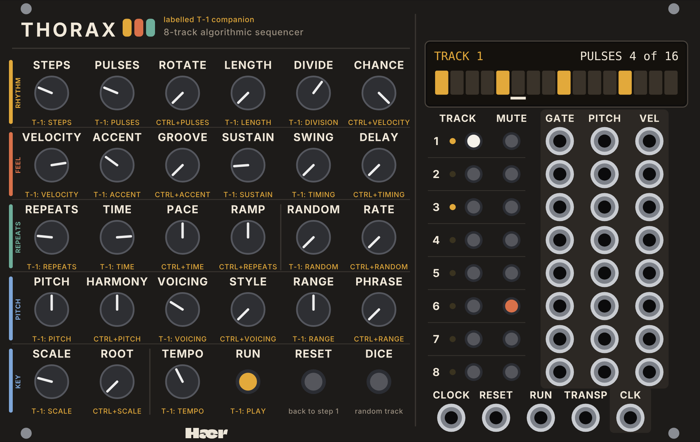

# Thorax

An 8-track algorithmic sequencer for VCV Rack 2, in the spirit of the Torso T-1,
with every control on its own clearly labelled knob. Under each knob, in amber, is
where that control lives on the T-1 (for example `CTRL+PULSES` means hold CTRL and
turn PULSES), so Thorax doubles as a way of learning the hardware.

- One set of knobs edits whichever track is selected (TRACK buttons 1-8), like the T-1.
- Euclidean STEPS / PULSES / ROTATE, LENGTH, DIVIDE, CHANCE.
- VELOCITY, ACCENT and GROOVE shapes, SUSTAIN, SWING, DELAY.
- REPEATS with TIME, PACE (bouncing ball) and RAMP (fade / build).
- PITCH, HARMONY, VOICING (chords) and STYLE (chord or arp), RANGE and PHRASE (cadences and LFO shapes), SCALE and ROOT per track.
- RANDOM and RATE, plus a DICE button.
- Per track: GATE, PITCH (polyphonic for chords) and VEL outputs, and a MUTE button.
- Internal TEMPO or external CLOCK (4, 24, 48 or 96 pulses per beat), RESET, RUN, TRANSPOSE in, CLOCK out.

The full guide, with a table mapping every control to the T-1, is in
[docs/Thorax-Guide.pdf](docs/Thorax-Guide.pdf).

Thorax is an independent project and is not affiliated with Torso Electronics.
The T-1 manual describes what each control is for but not the exact maths, so
some behaviours (repeat pacing, phrase shapes, chord styles, accent shapes) are
Thorax's own reading of them.

## Building

The plugin is built for Apple Silicon Macs by GitHub Actions on every push
(see `.github/workflows/build.yml`); the `.vcvplugin` file appears on the
"latest" (main) or "preview" (branches) release.

- Panel: `python3 res/make_panel.py` (needs `fonttools`), preview `python3 tools/preview.py panel-preview.png`.
- Engine check without Rack: `g++ -std=c++17 -I src tools/engine_test.cpp -o /tmp/et && /tmp/et`.

## Licence

MIT (see `LICENSE.txt`): you're free to use, change, port (VST/CLAP, other platforms, hardware) and share this code, as long as the copyright notice and licence text come along. Fonts on the panel (Inter, Climate Crisis) are under the SIL Open Font Licence.
